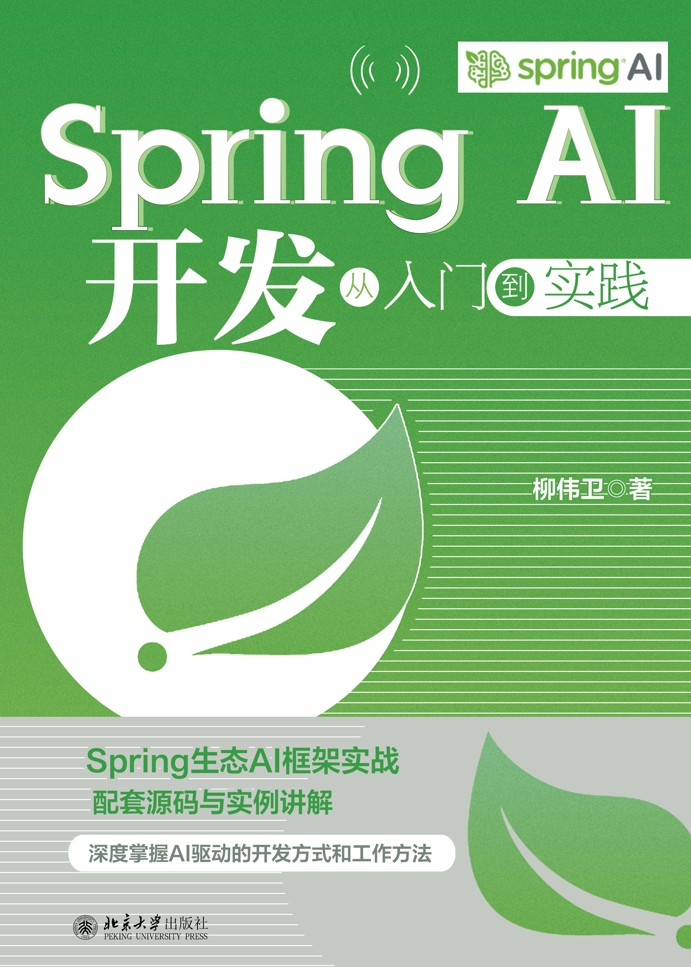

《Spring AI开发从入门到实践》已于近日上市，该书由北京大学出版社出版。该书主是Spring AI开发的实战宝典，内容包括原理精讲+项目落地+完整可运行代码，手把手带你掌握AI应用开发全流程，完成从传统Java开发到AI驱动开发的能力转型！

本文希望与读者朋友们分享下这本书里面的大致内容。

<!-- more -->

## 封面部分

首先是介绍封面部分。

《Spring AI开发从入门到实践》封面上方是本书的书名，清晰凸显出“Spring AI”字眼及官方项目标识。

封面整体色调是青色，小清新、富有活力。

封面左下角体现了本书的一些特色，比如：

* 本书附赠完整的配套源码与实例讲解。这对于大中院校的师生来说非常友好，直接可以将这本书作为学习鸿蒙的上课教材。
* 详细介绍 Spring 生态 AI 框架实战
* 深度掌握 AI 驱动的开发方式和工作方法
* 面向 Java 与 Spring 开发者，从零构建企业级生成式 AI 应用，打通大模型落地最后一公里

一句话推荐：一本书吃透Spring AI，掌握企业级AI应用开发与落地！

封面底部是出版社“北京大学出版社”字样。

## 封底部分

介绍封底部分。

封底部分较为简介，跟封面内容相似。

全书266页，厚度适中，定价为89元，不贵，非常极具有性价比。

## 本书特色

1. 全链路实战，学用一体：覆盖智能问答、聊天机器人、多模态系统、企业办公助手等完整项目案例，掌握Spring AI从开发、测试到上线运维全流程落地能力。 
2. 深度融合Spring技术生态：从环境搭建、核心组件解析，到Prompt工程、RAG、智能体、向量库集成，贴合Java开发者习惯，快速上手 AI 应用开发。 
3. 代码完整，工程化解析：配套大量可直接运行的工程源码，详解性能调优、安全防护、可观测性、容器化部署等企业级开发要点。 
4. 紧跟AI浪潮，把握开发新机遇：探索本地开源大模型、多模态、智能体、边缘AI等前沿方向，助力Java开发者抓住AI 驱动开发的技术红利。

## 内容简介

 
随着大语言模型（LLM）的爆发式发展，AI驱动开发已成为软件工程领域的核心趋势，而Spring AI作为Spring生态专为AI开发打造的框架，凭借其“约定优于配置”的设计理念、完善的组件生态和低门槛集成能力，成为Java开发者进军AI领域的首选工具。本书以“从入门到实践”为核心导向，系统梳理Spring AI开发的全流程知识，帮助读者快速掌握AI应用开发技能，实现从传统开发向AI驱动开发的转型。

全书共分为五大部分，构建了“基础认知—核心技术—实战应用—进阶拓展—前沿探索”的完整学习路径。第一部分从AI发展趋势与Spring AI核心价值切入，搭配环境搭建指南，帮助读者快速建立认知并完成开发准备；第二部分深入解析Spring AI核心组件与API，涵盖Prompt工程、LLM集成、向量嵌入、提示链、智能体与工具调用等核心技术，夯实开发基础；第三部分聚焦典型应用场景，通过智能问答系统、文本生成、聊天机器人、多模态交互、企业级集成等实战案例，让读者掌握技术落地方法；第四部分围绕性能优化、安全可观测、测试评估、生产部署展开，提供企业级应用上线的全流程保障方案；第五部分探索Spring AI生态与前沿方向，包括开源LLM本地化部署、Agent生态进阶等内容，助力读者把握技术发展趋势。

本书兼顾理论深度与实践价值，每个技术点均配套实例讲解，核心章节设置完整实战项目，同时融入智能体、会话记忆、多模态交互等前沿内容。无论是零基础想入门AI开发的Java开发者，还是需要落地AI项目的企业研发人员，亦或是希望拓展技术边界的IT从业者，都能从本书中获得系统的知识体系与实用的开发指导。阅读本书后，读者将具备独立设计、开发、部署Spring AI应用的能力，轻松应对企业级AI项目的开发需求。

全书总共包含21章，包括：

* 第一部分 基础认知（第1~3章）：从AI发展趋势与Spring AI核心价值切入，搭配环境搭建指南，帮助读者快速建立认知并完成开发准备。
* 第二部分 核心技术（第4~9章）：深入解析Spring AI核心组件与API，涵盖Prompt工程、LLM集成、向量嵌入、提示链、智能体与工具调用等核心技术，夯实开发基础。
* 第三部分 实战应用（第10~14章）：聚焦典型应用场景，通过智能问答系统、文本生成、聊天机器人、多模态交互、企业级集成等实战案例，让读者掌握技术落地方法。
* 第四部分 进阶拓展（第15~18章）：围绕性能优化、安全可观测、测试评估、生产部署展开，提供企业级应用上线的全流程保障方案。
* 第五部分 前沿探索（第19~21章）：探索Spring AI生态与前沿方向，包括开源LLM本地化部署、Agent生态进阶等内容，助力读者把握技术发展趋势。

本书不仅详细阐述了相关理论知识，还配合核心功能给出了诸多开发案例，旨在通过实际操作提升读者的动手能力和解决实际问题的能力。更多介绍，详见“参考引用”。

## 写作背景

在2018年的时候，笔者在北京大学出版社出版了“Spring三剑客”，分别是《Spring Boot 企业级应用开发实战》《Spring Cloud 微服务架构开发实战》《Spring 5 案例大全》。彼时，正是微服务架构、中台架构盛行，Spring Boot和Spring Cloud是构建分布式系统的事实标准。而随着近些年AI大模型技术的爆发，Spring家族也迎来它的新成员——Spring AI——致力于构建AI领域新的事实标准。本书致力于向广大读者推广这门Spring AI技术。

## 源代码

本书提供的素材和源代码可从以下网址下载：
<https://github.com/waylau/spring-ai-tutorial>

## 勘误和交流

本书如有勘误，会在以下网址发布：
<https://github.com/waylau/spring-ai-tutorial/issues>

## 参考引用

* 原文同步至：<https://waylau.com/about-spring-ai-tutorial-book/>
* 视频介绍可见B站：<https://www.bilibili.com/video/BV1Q9xr6qEvU/>
* [京东](https://item.jd.com/15534218.html)
* [当当](http://product.dangdang.com/30120316.html)

